# GoPay 虚拟卡订阅 AI 会员完整教程

用 GoPass 美国虚拟卡订阅 ChatGPT Plus（菲律宾半价区）、Claude Pro 等 AI 会员的完整图文教程。

**配套视频教程：**

---

## 一、办理 GoPass 美国虚拟卡

> 不需要护照，仅需身份信息即可。

### 1. 关注公众号，进入申请入口

打开微信，搜索并关注 **「GO PAY TECH」**。在公众号底部功能栏点击「GoPass」，再选择 **「申请数字通行证」**。

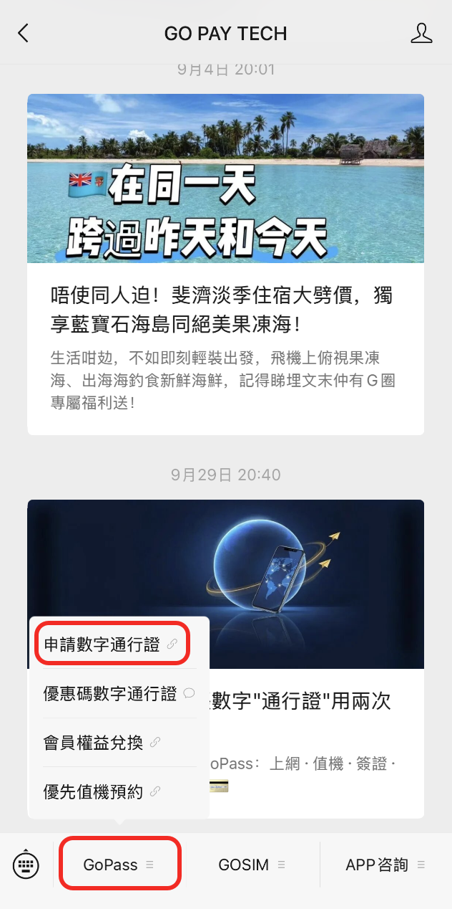

### 2. 选择 Lite 数字通行证，填写申请信息

> AI 订阅建议选最便宜的 Lite 即可。

选择 Lite 或 Pro 数字通行证，然后填写要求的信息。**下图红框处填写优惠码：`VVIP005`**，可减免 45–79 港币开卡费用。

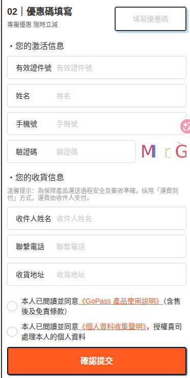

**Lite / Pro 数字通行证价格对比：**

| 套餐 | 官网原价 | 优惠码 | 专享价 | 约合人民币 | 减免 |
| --- | --- | --- | --- | --- | --- |
| GoPass · Lite 通行证（推荐，可订阅 Claude / GPT 等） | 150 港币 | `VVIP005` | 105 港币 | 约 89 元 | 45 港币 |
| GoPass · Pro 通行证 | 201 港币 | `VVIP003` | 122 港币 | 约 105 元 | 79 港币 |

核对信息与应付金额后完成购买。

**注意事项：**

- Lite 门槛费用最低 89 元人民币（即 105 港币）；即便平台审核不通过拒绝开卡，这 89 元**可以退款**（退款教程见第二部分问题 2）。
- 收货信息填你常用的国内收货信息即可。开卡后会附带寄送一张 SIM 实体卡，该 SIM 卡只能在境外激活用流量（不能接码），且**邮费到付**。不需要的话直接拒收即可，无需付邮费。

### 3. 下载并登录 GoPay App

- 下载地址：<https://gopaytech.net/download>
- 或回到公众号，点击「APP咨询」→「下载APP」。

安装后打开并登录，优先使用申请时的账号或手机号；已有账号可按登录页提示使用邮箱等方式登录，新用户以 App 提示为准。

### 4. 在 App 中添加数字通行证

登录后点击底部「GoPass」，再点击「GoPay」。

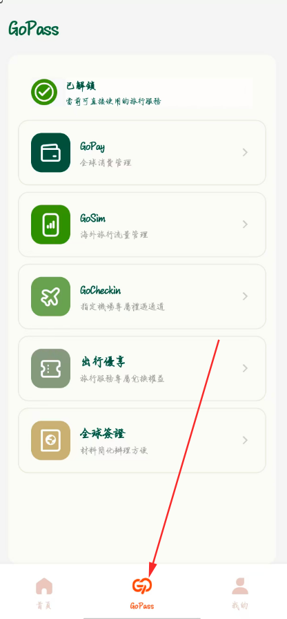

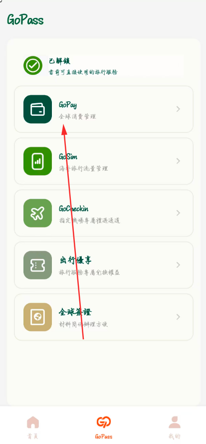

点击 **「新增」→「数字通行证」**，核对身份信息，并按页面要求完成验证。

- 这一步的**英文地址**把国内常用地址翻译成英文即可（**不需要**填香港或国外地址）。
- 如果弹出需要上传截图补充材料，参考第二部分「问题 1」的解决方法。

> ⚠️ 如遇问题发截图提问，**一定要打码卡号和 CVV！**

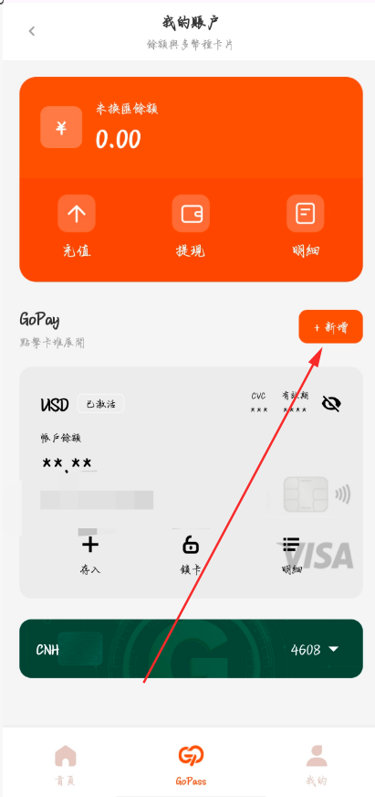

### 5. 充值人民币，再存入美元

在 App 中进入「GoPass」→「GoPay」，点击「充值」。

> 💡 用多少充多少，不要多充，余额可保持为 0，要续费会员的时候再充值。

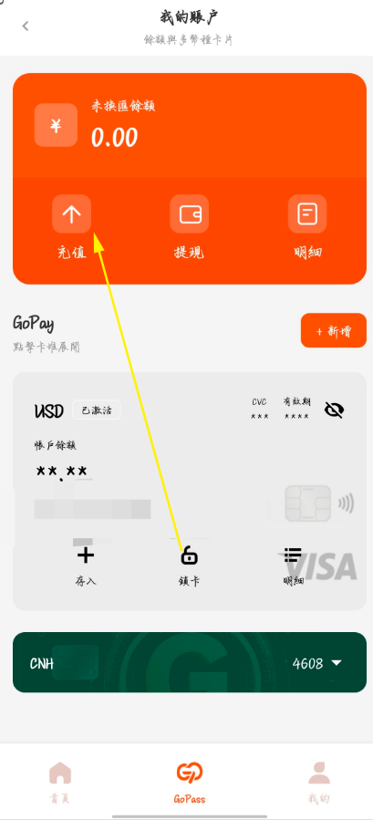

1. 复制充值页面显示的收款卡号。
2. 打开自己的银行 App（中国银行、招商银行、农行等均可，**不要用云闪付**），按充值页说明填写收款账号及本人姓名并转账，核对收款信息后再操作。
3. **第一笔先只充值 35 元人民币（即 5 美元）激活卡**，卡里就会有余额 5 美元，这 5 美元可完全消费掉。

人民币到账后，选择对应卡片并点击「存入」。页面会显示汇率和需要扣除的人民币金额，核对后按提示购汇、存入美元。

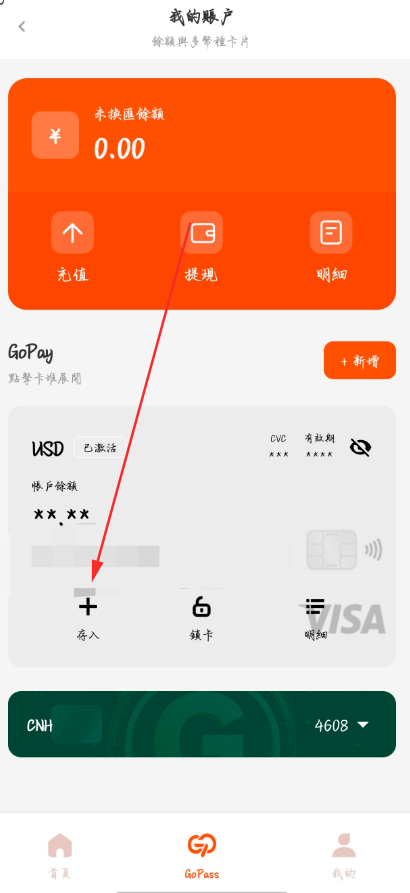

选择刚开的美国卡并**存入**美元：

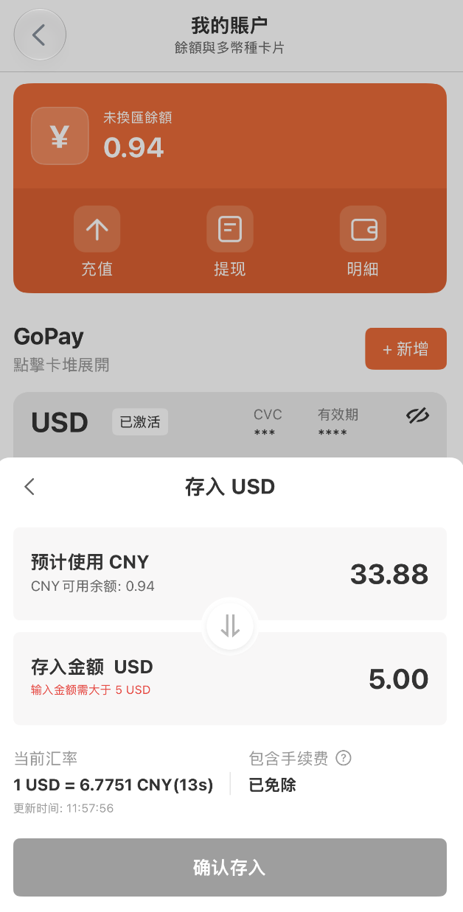

> **首次使用前，先充值 35 元人民币（5 美元）激活账户即可，激活只需 5 美元，激活后可以消费掉这 5 美元。**

---

## 二、常见问题解决方案

### 问题 1：申请时要求补充验证材料；或使用后变成已锁卡状态（需补充境外图）

可按审核要求准备**携程酒店预订单**或**前往九龙的高铁订单**等材料。

**方法 1：酒店材料（群友实测有效）**

1. 在携程（微信小程序即可）预订 1 个月后的香港或国外任意酒店，**筛选允许免费退款的酒店**。
2. 点击「报销凭证」→ 发送邮箱 → 在邮箱下载酒店水单 PDF 并截图，填入审核材料即可通过。
3. 需使用**本人真实订单**，确保姓名、日期等信息清晰可见。审核通过后再取消酒店预订退款，即可免费通过开卡验证。

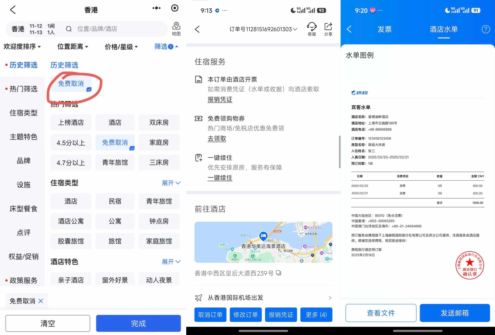

也可以用 Booking 预订，选「到店付款」（不需付款），发截图过审核之后免费取消预订即可。

**方法 2：交通材料**

有网友提到用**深圳 → 九龙的高铁订单**截图，审核通过后再取消高铁订单。

**锁卡处理：** 如果开卡时没遇到补充材料这步，但后续美元卡出现锁卡情况，把上述酒店水单截图发邮件给客服邮箱 **Customerservice@gopaytech.net**，等待 1 天左右即可解锁。

> 提交补充材料后一般 1–2 个工作日内审核完成，快的话几小时，耐心等待即可。

### 问题 2：一直审核不通过无法开卡的退款流程

把**审核不通过的截图**和**已购买的套餐订单截图**发送邮件给官方客服邮箱，邮件里说明自己的情况、无法申请、需要退款，并附上账户绑定的**姓名、邮箱、手机号**。等几小时或 1–2 个工作日，开卡费会全额退回。

### 问题 3：绑卡失败，或提示安全码错误

客服答复：**需要先「充值并存入」5 美元，激活账户后再使用。**

处理顺序：

1. 先检查「充值并存入」的美元是否已经到账、账户是否处于可用状态。
2. **首次充值之后最好等待 1 天再订阅**（美国银行入账可能有延迟）。
3. 核对卡号、有效期和安全码无误后重新绑定。
4. 若仍无法绑卡，联系 App 内的 GoPay 客服企业微信解决。

---

## 三、网友实测记录

> 开卡激活之后，48 个月 GPT Team 半价优惠、教育优惠 Plus 的教程：
> [【完整教程】48 个月 GPT Team 会员开卡、转长链接绑卡订阅教程（含 GoPay、Gate、Roogoo、Bybit 等开卡教程，教育优惠 GPT Plus 会员绑卡也是用本教程的卡）](https://s.craft.me/fbQzGQ154Q6VnQ)

### ChatGPT 网页订阅：成功付款

网友实测，开通卡片后尝试 ChatGPT 一个月试用，验证通过并成功支付。另一位网友反馈，有首月试用资格的账号经多次尝试后，直接使用卡片成功付款，没有使用转链技巧；其成功环境为**美国网络 + 手机 Chrome 无痕模式 + 真实美国账单地址**（个案环境记录，不代表都能白嫖 0 美元的 GPT Plus 试用）。

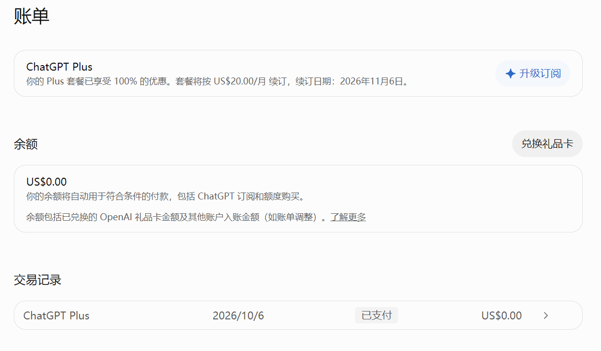

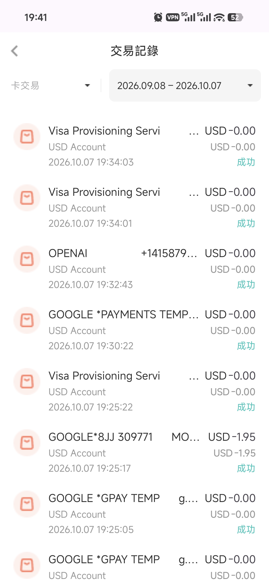

### Claude Pro 会员美区：实测可直接绑卡订阅

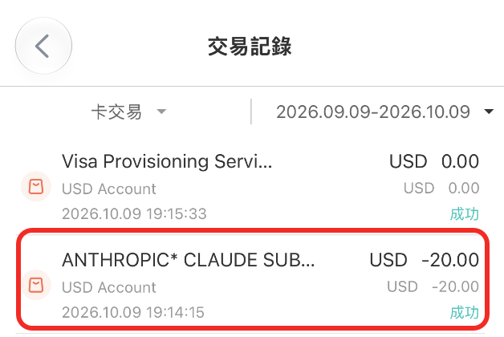

### ChatGPT Go 会员菲律宾区：有新账号开通记录

网友实测，新注册的 ChatGPT 账号使用 GoPay 卡成功开通菲律宾区 ChatGPT Go（选的最低档方案测试），GPT Plus 和 Pro 会员菲律宾低价区也可开通。

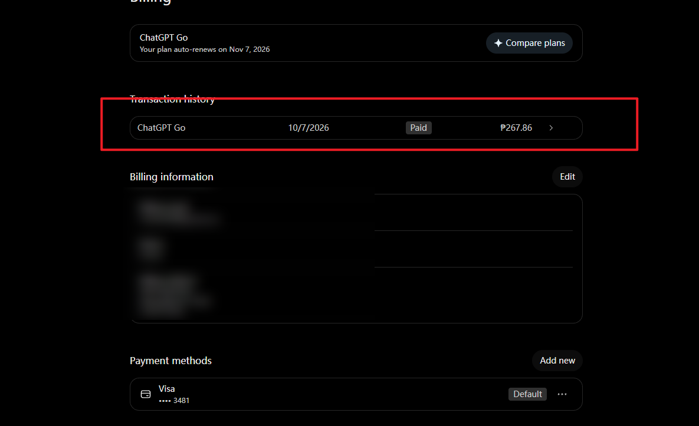

### Apple Pay：有绑卡及 200 美元订阅付款反馈

网友实测，绑定 Apple Pay 后成功完成 200 美元订阅付款，账单地址使用美国地址。

### OpenAI 开发者平台 / API：网友实测可绑定

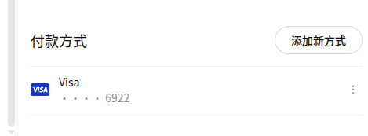

### Google Pay、美区 App Store、Google Play、美区 PayPal：有绑定成功反馈

网友实测这些平台均可绑定该卡。**美区 App Store 绑定技巧：** 开全局代理，账单地址写代理 IP 附近的美国地址，姓名填开卡时的拼音姓名但**姓和名反过来写**，即可绑定成功。

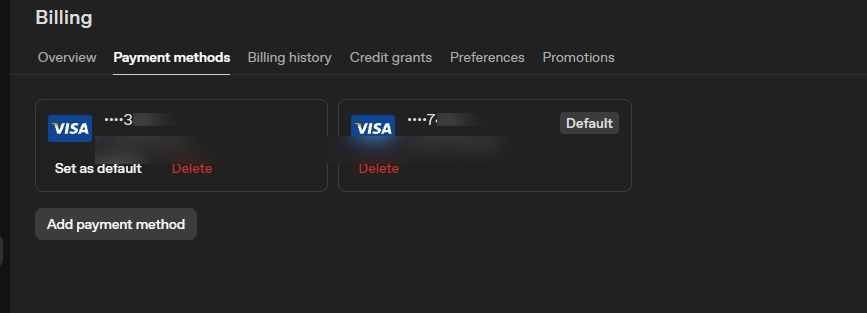

### Claude API：有成功付款案例

有网友转述使用该卡支付 Claude API 成功，可供参考。

### Claude 会员 KYC 提示

有网友反馈到了 KYC 这步，未继续尝试最终能否绑卡成功，可自行测试。此卡绑卡失败不会有任何影响，也不会扣手续费。

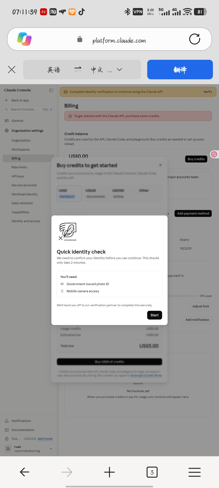

---

## 四、申请 GOPAY 新加坡实体卡（门槛较高）

流程：先在 **「GO PAY TECH」** 公众号上提交**新加坡材料**预约，预约审核通过后官方会回复邮件，邮件确认之后才可以在官网购买新加坡实体卡。

**新加坡实体卡专享优惠码：**

| 类型 | 套餐 | 优惠码 |
| --- | --- | --- |
| 实体卡邮寄到手 | GoPass · 輕旅環遊版 | `VIP005` |
| 实体卡邮寄到手 | GoPass · 環遊尊享版 | `VIP003` |

新加坡实体卡开卡门槛较高，没有新加坡材料的话按前面教程办理美国虚拟卡即可。

---

## 免责声明

以上教程整理自互联网公开信息及个人实测补充，仅供学习参考。涉及第三方平台（GoPay、OpenAI、Anthropic 等）的规则和政策可能随时变化，请以各平台官方说明为准，操作风险自担。
